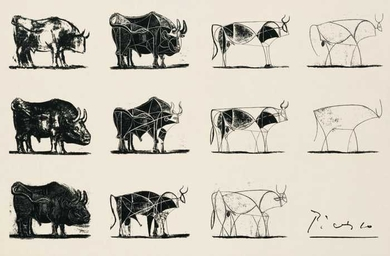

> “You cannot stay on the summit forever; you have to come down again. So why bother in the first place? Just this: What is above knows what is below, but what is below does not know what is above. One climbs, one sees. One descends, one sees no longer, but one has seen. There is an art of conducting oneself in the lower regions by the memory of what one saw higher up. When one can no longer see, one can at least still know.” -Rene Daumal

Hello, my name is Adhiraj. I am a math student. I am currently teaching myself *introductory abstract algebra* and *ordinary differential equations*. I enjoy studying mathematics. I think problem solving, especially the mathematical kind, is a rewarding experience. I intend to take up mathematics in university. Apart from mathematics, I like reading fiction books. Currently I am reading *Moby Dick* by Herman Meville and *the Brothers Karamazov* by *Fyodor Dostoevesky*. I enjoy nature. In my free time, I am learning programming.

<figure>
  
  <!-- <figcaption>Le Taureau (the Bull), Pablo Picasso, 1946</figcaption> -->
</figure>
 
**Le Tareau** (the Bull) is a series of lithographs by *Pablo Picasso*. He progressively simplifies the drawing of a bull until it becomes a geometric shape. What stands out to me about this piece is that it shares a process. I think sharing one's *creative process* generates a lot of value for one's self as well as others. For one's self, it is an opportunity to look at the progress they have made and for others, it is a peek into how the person things. It is something I wish to do.