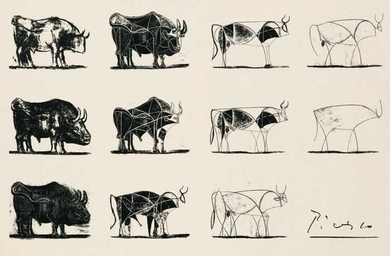

> “You cannot stay on the summit forever; you have to come down again. So why bother in the first place? Just this: What is above knows what is below, but what is below does not know what is above. One climbs, one sees. One descends, one sees no longer, but one has seen. There is an art of conducting oneself in the lower regions by the memory of what one saw higher up. When one can no longer see, one can at least still know.” -Rene Daumal

Hello, my name is Adhiraj. I am a math student. I am currently teaching myself *introductory abstract algebra* and *ordinary differential equations*. I really enjoy the creativity one can employ in mathematics. Studying mathematics makes me happy. I think problem solving, especially the mathematical kind, is a rewarding experience. Studying math also allows to me study something very broad. I am currently self-taught and I hope to study mathematics in university.

Apart from mathematics, I like reading fiction books. Currently I am reading *Moby Dick* by Herman Meville and *the Brothers Karamazov* by *Fyodor Dostoevesky*. I enjoy nature. In my free time, I program sometimes.

<figure>
  
  <!-- <figcaption>Le Taureau (the Bull), Pablo Picasso, 1946</figcaption> -->
</figure>
 
**Le Tareau** (the Bull) is a series of lithographs by *Pablo Picasso*. He progressively simplifies the drawing of a bull until it becomes a geometric shape. What stands out to me about this piece is that it shares a process. I think expressing one's *creative process* generates a lot of value for one's self as well as others. It is something I will try to do with math. I believe everybody has a different process and different heuristics and I would like to share my ways. This also stood out to me because I think math is similar in a way. A proof can be progressively distilled into simpler chunks and finally to a few important ideas. 